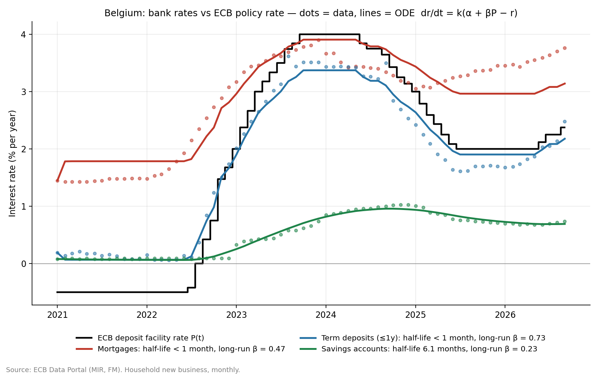

# How slowly do Belgian banks pass ECB rate hikes on to savers?

*Project for Advanced Mathematics for Business and Technology (VUB, 2026–27).*

**🌐 Website: https://ssadigov532-collab.github.io/belgian-savings-passthrough/**



## Question

Between July 2022 and September 2023 the European Central Bank raised its
deposit facility rate from **−0.50 % to 4.00 %**. Belgian mortgage rates rose
quickly, but the rate on the Belgian savings account barely moved. This became a
public debate in 2023. In September 2023 the Belgian government issued a one-year
state note directly to households, and it raised about €22 billion.

> **How fast, and how far, do Belgian banks pass changes in the ECB policy rate
> on to savers? How does Belgium compare with Germany, France, the Netherlands
> and with Belgian mortgage rates?**

## Data

All data comes from the [ECB Data Portal](https://data.ecb.europa.eu/), which is
public and needs no login. It is monthly data from January 2003 to September
2026, for Belgium (`BE`), Germany (`DE`), France (`FR`), the Netherlands (`NL`)
and the euro area (`U2`).

| Series | ECB key | Meaning |
|---|---|---|
| ECB deposit facility rate | `FM.D.U2.EUR.4F.KR.DFR.LEV` | policy rate (daily, averaged per month) |
| Savings accounts | `MIR.M.{country}.B.L23.D.R.A.2250.EUR.N` | household deposits redeemable at notice ≤ 3 months |
| Current accounts | `MIR.M.{country}.B.L21.A.R.A.2250.EUR.N` | household overnight deposits |
| Term deposits ≤ 1y | `MIR.M.{country}.B.L22.F.R.A.2250.EUR.N` | new business, households |
| Mortgages | `MIR.M.{country}.B.A2C.A.R.A.2250.EUR.N` | loans for house purchase, new business |

The downloaded files are in `data/raw/`, and the tidy monthly table used by
every analysis is `data/processed/rates_monthly.csv`. To download everything
again, run `python src/01_download_data.py`.

## Analyses

### Analysis 1: first-order linear ODE (`src/02_ode_model.py`)

The bank rate *r(t)* moves towards a long-run target that depends on the ECB rate *P(t)*:

$$\frac{dr}{dt} = k\,\big(\alpha + \beta P(t) - r(t)\big)$$

- **k** is the adjustment speed. The half-life is ln 2 / k months, and each month
  the bank closes a share 1 − e^(−k) of the gap.
- **β** is the long-run pass-through. A 1 pp ECB hike eventually raises the bank
  rate by β pp.
- **α** is the long-run spread.

This is a linear, non-homogeneous, first-order ODE. With the integrating factor
e^(kt), and the ECB rate held constant within each month, the exact solution is
r(n) = r\*ₙ + (r(n−1) − r\*ₙ)·e^(−k) with r\*ₙ = α + βPₙ. I solve it forward from
January 2021 and estimate (k, α, β) by non-linear least squares
(`scipy.optimize.least_squares`). As a check, I also integrate it numerically
with `scipy.integrate.solve_ivp`; the maximum difference is 1e-6 pp.

### Analysis 2: pass-through measures that assume less (`src/03_passthrough_regression.py`)

- **(A) Phase betas.** β = Δ bank rate / Δ ECB rate for the hiking phase
  (2022-06 → 2024-05) and the cutting phase (2024-05 → 2025-12).
- **(B) Distributed-lag regression** on the full 2003–2026 history:
  Δrₜ = c + Σⱼ₌₀¹² bⱼ ΔPₜ₋ⱼ + εₜ. It is estimated by OLS with Newey–West (HAC)
  standard errors. The cumulative sum B(h) = b₀ + … + b_h is the share of an ECB
  move passed on after h months. This regression assumes no functional form, so
  it checks the ODE's exponential path.

## Main findings

| Savings accounts | ODE β | ODE half-life | β hiking | β cutting | DL B(12) |
|---|---|---|---|---|---|
| **Belgium** | **0.23** | **6.1 months** | **0.19** | **0.12** | **0.30** |
| Germany | 0.19 | 7.5 months | 0.15 | 0.02 | 0.24 |
| France* | 0.45 | < 1 month | 0.40 | 0.49 | 0.55 |
| Netherlands | 0.43 | 5.0 months | 0.36 | 0.17 | 0.37 |
| Euro area | 0.31 | 2.3 months | 0.29 | 0.27 | 0.38 |

\*France's savings rate is mostly the government-set Livret A rate.

1. **Belgian savers received about a fifth of the ECB's hikes.** Three methods
   give β = 0.19–0.30. When the ECB paid banks 4 %, the savings rate peaked at
   1.03 % (November 2024).
2. **It was slow.** The half-life is 6.1 months, so the savings rate closed only
   about 11 % of its gap per month. It was still 0.09 % in December 2022.
3. **Banks can move fast when they have to.** Belgian one-year term deposits passed
   on 73 % of the hikes within the same month, and mortgages started rising before
   the first ECB hike. The stickiness is specific to savings and current accounts.
4. **Belgium was among the lowest, together with Germany.** Its savings pass-through
   was below the euro area and the Netherlands.
5. **On the way down, savings rates were also sticky** (β = 0.12 during the cuts).

**Limitations:** the ODE has no anticipation term, so mortgages, which are priced
off market expectations, fit less well (R² 0.85). Monthly data cannot resolve
adjustment faster than one month. The figures are national averages, and Belgian
savings rates include a loyalty premium.

## Figures

| File | Content | Made by |
|---|---|---|
| `figures/fig1_belgium_ode_fit.pdf` | Belgian rates: data vs solved ODE | `src/02_ode_model.py` |
| `figures/fig2_country_comparison.pdf` | pass-through and half-life by country | `src/03_passthrough_regression.py` |
| `figures/fig3_cumulative_passthrough.pdf` | cumulative pass-through B(h) with 95 % CI | `src/03_passthrough_regression.py` |

## Reproduce

```bash
pip install -r requirements.txt
python src/01_download_data.py          # download ECB data
python src/02_ode_model.py              # Analysis 1 + Figure 1
python src/03_passthrough_regression.py # Analysis 2 + Figures 2-3
python src/04_build_website_data.py     # copy figures + data.json into docs/
```

The website is a static page in `docs/`, served by GitHub Pages.

## Repository structure

```
├── README.md
├── requirements.txt
├── data/
│   ├── raw/                     # ECB files as downloaded
│   └── processed/rates_monthly.csv
├── src/
│   ├── 01_download_data.py
│   ├── 02_ode_model.py          # Analysis 1
│   ├── 03_passthrough_regression.py  # Analysis 2
│   └── 04_build_website_data.py
├── results/                     # parameter tables and fitted paths (CSV)
├── figures/                     # figures as PDF (+ PNG)
└── docs/                        # website source (index.html, data.json, figures)
```
